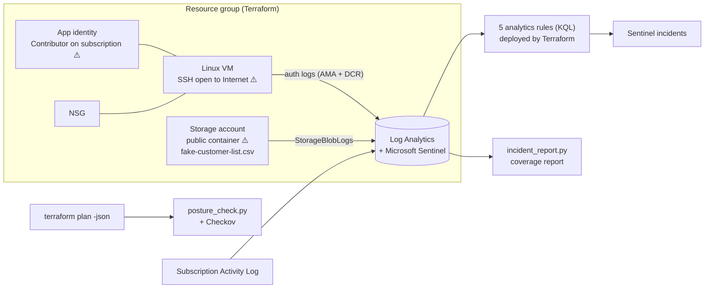

# Azure Cloud Security Lab — from Misconfiguration to Detection

A hands-on cloud security project on Microsoft Azure. I deployed a small environment with **Terraform** in two
versions — deliberately **misconfigured**, then **hardened** — found the problems with my own **policy-as-code
checker** (Python) and Checkov, simulated the attacks those misconfigurations allow, detected them with
**Microsoft Sentinel** rules written in KQL (deployed as code), and mapped everything to **MITRE ATT&CK**,
the **CIS Microsoft Azure Foundations Benchmark** and **ISO/IEC 27001:2022**.

> **Scope & ethics:** everything runs in my own Azure for Students subscription, against resources this
> project creates. The "customer data" is fake. No third-party system is touched.

---

## What this project shows

| Skill | Where |
|---|---|
| Infrastructure as Code (Terraform, azurerm) | [`terraform/`](terraform/) |
| Cloud misconfiguration analysis (policy-as-code in Python + Checkov) | [`scripts/posture_check.py`](scripts/posture_check.py) |
| Cloud logging pipeline (Activity Log, Azure Monitor Agent, DCR, Log Analytics) | [`terraform/main.tf`](terraform/main.tf), [`terraform/compute.tf`](terraform/compute.tf) |
| SIEM detection engineering (Microsoft Sentinel, KQL, detection-as-code) | [`detections/`](detections/), [`terraform/sentinel_rules.tf`](terraform/sentinel_rules.tf) |
| Adversary simulation in the cloud (az CLI) | [`simulation/`](simulation/) |
| Incident reporting & detection coverage (Python + Azure CLI) | [`scripts/incident_report.py`](scripts/incident_report.py), [`report/`](report/) |
| GRC: CIS Azure Benchmark, ISO 27001 mapping, risk register | [`grc/`](grc/) |
| Testing | [`tests/`](tests/) — `python3 -m unittest discover -s tests -v` |

## Architecture

## The misconfigurations (insecure mode) and their fixes (secure mode)

| # | Misconfiguration | Attack it enables | Detected by | Fix in secure mode |
|---|---|---|---|---|
| 1 | SSH port open to `*` | Brute force (T1110) | C01 | Source = my IP only |
| 2 | Public blob container | Data theft (T1530) | C04 | Container private, no anonymous access |
| 3 | App identity = Contributor on the subscription | Privilege escalation (T1098.003) | C02 | Reader on the resource group |
| — | Firewall rule added by an attacker | Defense evasion (T1562.007) | C03 | Change control + alert |
| — | Logging switched off by an attacker | Defense evasion (T1562.008) | C05 | Alert + least privilege |

## Detections

| ID | Detection | Table | ATT&CK | Severity |
|---|---|---|---|---|
| C01 | SSH brute force against a VM | Syslog | T1110.001 / .003 | Medium |
| C02 | Role assigned (privilege escalation) | AzureActivity | T1098.003 | High |
| C03 | Network security rule created or changed | AzureActivity | T1562.007 | Medium |
| C04 | Anonymous read of storage blobs | StorageBlobLogs | T1530 | High |
| C05 | Logging disabled (diagnostic setting deleted) | AzureActivity | T1562.008 | High |

## Results

> _Fill in with YOUR real results. Do not copy the test fixtures._

**Posture check — before vs after**

| | Insecure plan | Secure plan |
|---|---|---|
| posture_check.py findings (high / medium / low) | | |
| Checkov failed checks | | |

**Detection coverage** (from `report/incident-summary.md`): _x / y simulated steps detected_

**Real Internet traffic:** _how many different IPs tried SSH in the first hour?_

**Screenshots:** `docs/img/` — Sentinel incidents, KQL results, posture report, `terraform plan` diff.

**Demo video (2 min):** _link_

## How to run it

1. Setup (Azure for Students, Cloud Shell): [`docs/01-setup.md`](docs/01-setup.md)
2. Full walkthrough (deploy → scan → attack → detect → fix → re-scan): [`docs/02-run-the-lab.md`](docs/02-run-the-lab.md)
3. Cost and safety rules: [`docs/cost-and-safety.md`](docs/cost-and-safety.md)
4. 14-day plan: [`docs/14-day-plan.md`](docs/14-day-plan.md)

## What I learned

> _4–6 honest bullet points after you finish (what broke, what surprised you, what you would do differently)._

## Limitations & next steps

- Single subscription, no Entra ID (Azure AD) sign-in logs: those need a paid Entra ID P1/P2 licence.
- Detection thresholds are tuned for a lab; production needs baselining and allow-lists.
- Next: Defender for Cloud recommendations export, a GitHub Actions pipeline that runs `posture_check.py --fail-on high` on every pull request, and an AWS version.
